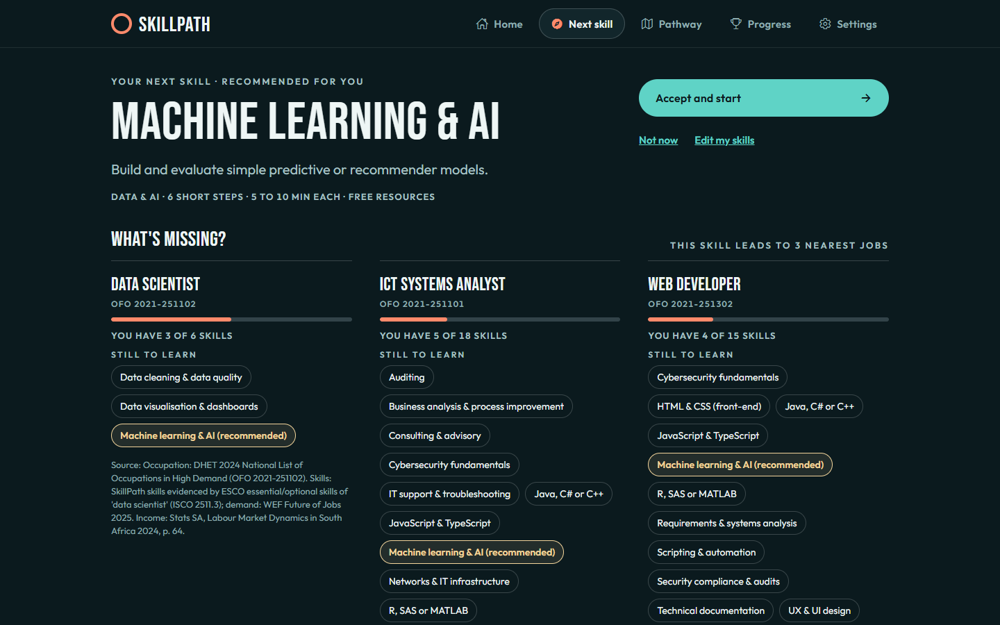
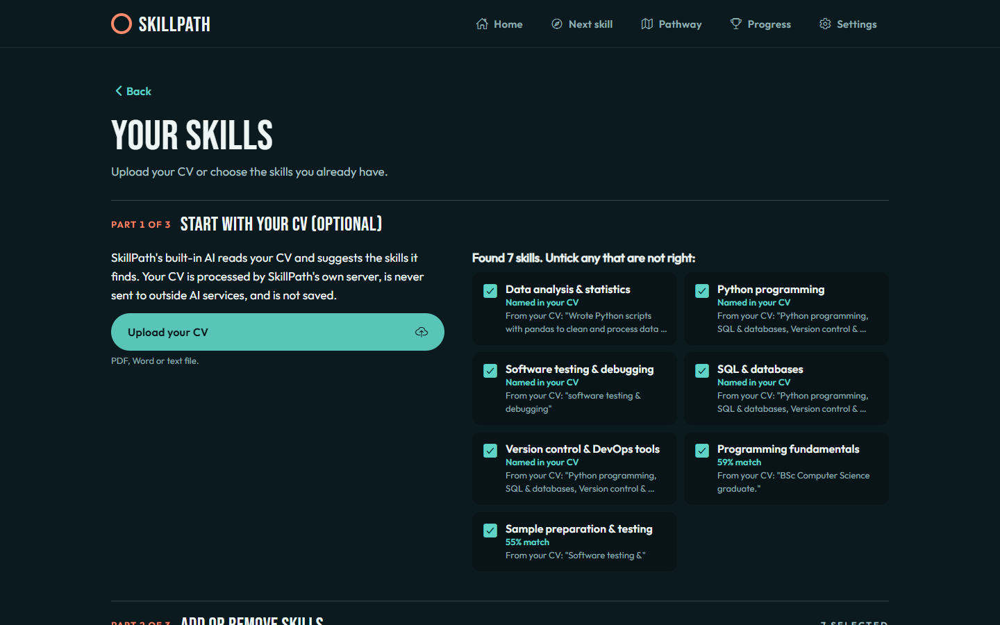
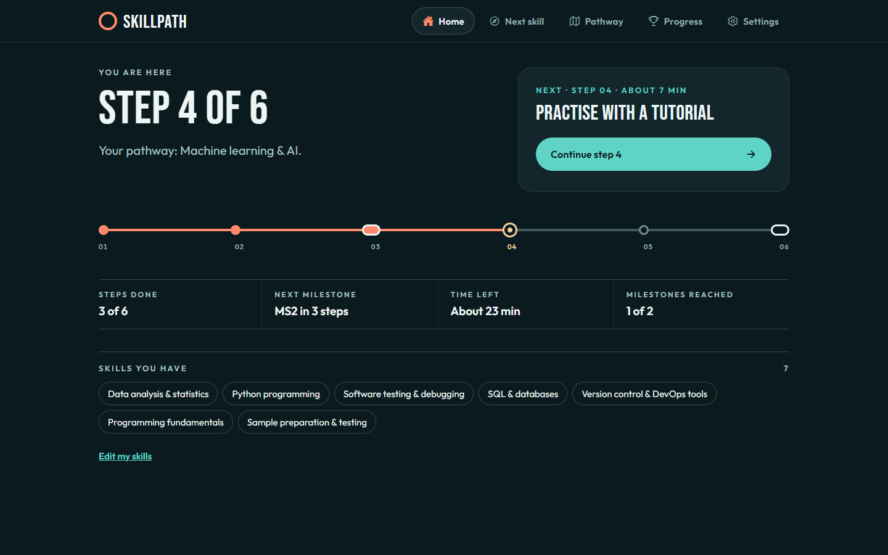
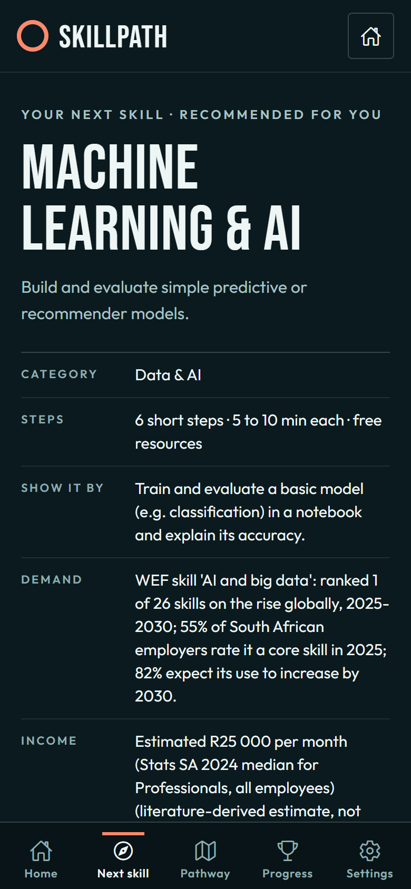
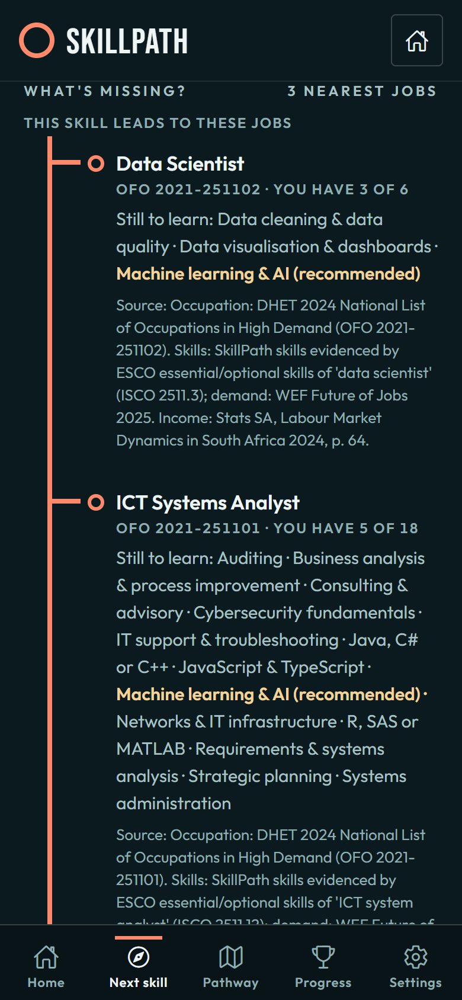
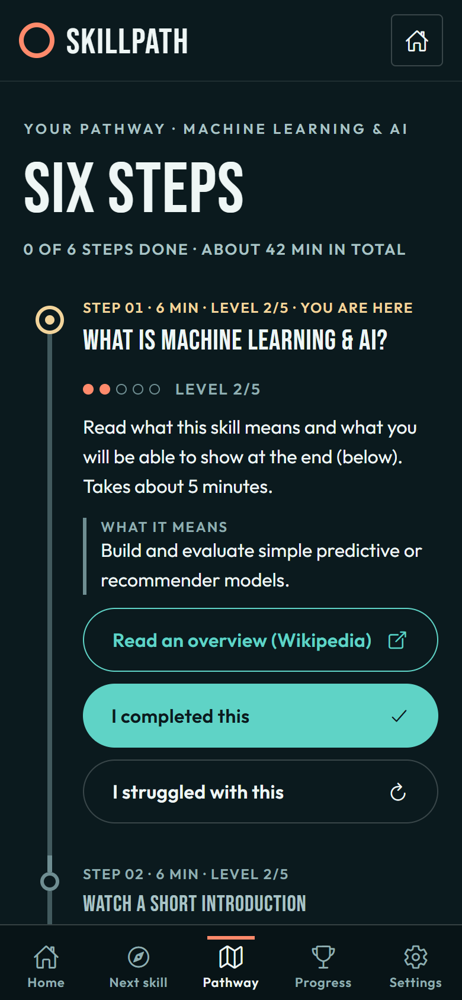
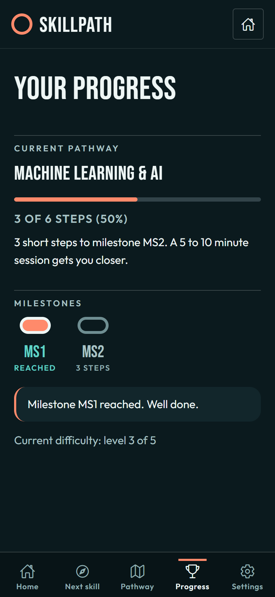
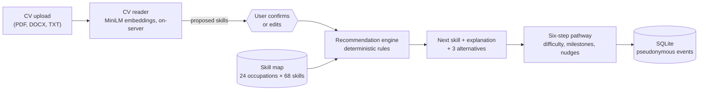

<div align="center">

# SkillPath

**Tells a graduate which one skill to learn next, shows why, and gets them started in six short steps.**

[](https://skillpath-demo.onrender.com)




</div>

## What it does

A lot of new graduates in South Africa know they need "more skills" but can't tell which one is worth their next
few weekends. SkillPath answers that with one recommendation instead of a list of fifty courses.

1. **Read the CV.** You upload a CV (PDF, Word or text) and a small AI model running on SkillPath's own server picks
   out the skills it finds, quoting the line in the CV each one came from. You untick anything that's wrong.
2. **Pick the next skill.** The engine finds the three jobs closest to your current skill set, then picks the one
   missing skill that moves you closest to all three at once. It shows its working: the jobs, how many of their
   skills you already have, what's still missing, and the official source for every figure.
3. **Learn it in six steps.** Each step takes 5 to 10 minutes and uses free resources. Difficulty rises as you
   pass steps and eases off if you struggle twice in a row, there's a milestone every three steps, and a reminder
   appears if you've been away for two days.

**Try it:** [skillpath-demo.onrender.com](https://skillpath-demo.onrender.com). It's on a free plan, so the first
visit can take about a minute to wake up. Use one of the fictional CVs in
[`samples/example_study/cvs`](samples/example_study/cvs) if you'd like to test the CV reader.

## Screens

| Upload a CV | Your progress |
|---|---|
|  |  |

On a phone it has its own layout, with bottom tabs:

<p>




</p>

## How it works



**The recommendation engine** ([`skillpath/engine.py`](skillpath/engine.py)) is plain rules, no machine learning.
It scores how close you are to each occupation with Jaccard similarity (skills you share with the job, divided by
all the skills either of you has), takes the three nearest, and tries every skill you don't have yet. Whichever
skill raises the average similarity across those three jobs the most wins. I used exact fractions rather than
floats, because two candidates that are mathematically tied can come out a hair apart in floating point, and then
the alphabetical tie-break never gets a say. So the same profile gives the same answer every time, which the
evaluation depends on.

**The CV reader** ([`skillpath/cv.py`](skillpath/cv.py)) splits a CV into short phrases and compares each one with
every skill's name and description using `all-MiniLM-L6-v2`, a small open-source sentence-embedding model run
through ONNX. A skill is suggested when a phrase is close enough in meaning (cosine similarity of 0.55 or more) or
names it outright. The model runs on SkillPath's own server, so a CV never goes to a third-party AI service, and
the file isn't stored. It only ever suggests: the user confirms every skill before the engine sees it.

**The skill map** is built by a script ([`scripts/build_skill_map.py`](scripts/build_skill_map.py)) from public
sources, so every cell can be traced back:

- occupations from the DHET 2024 National List of Occupations in High Demand,
- each occupation's essential skills from the European ESCO API,
- demand figures from the WEF *Future of Jobs Report 2025*,
- earnings from Stats SA's *Labour Market Dynamics in South Africa, 2024*.

## Engineering notes

- **Testable by design.** The engine has no clock, randomness or network. A pytest suite covers the engine,
  the API, the CV reader and an end-to-end run of the evaluation harness, and one test fails if the engine so much
  as reads a field holding the expected answer.
- **Reproducible results.** `run_evaluation.py` runs the whole evaluation and writes a replication package with
  the git commit, package versions, engine constants and a SHA-256 hash of every file. It refuses to run on
  uncommitted code. The results in the report come from the tagged build `v1.0-eval`.
- **Built-in A/B test.** Users are split into two versions by the parity of a SHA-256 hash of their ID: one shows
  estimated income for the recommended skill, the other doesn't. Income is only added after ranking, so it can
  inform without steering the recommendation.
- **Privacy (POPIA).** No names, emails or phone numbers. Users get a random ID, data lives in SQLite with no
  third-party analytics, and *Delete my data* removes every row for that user.
- **One container, free hosting.** A multi-stage [`Dockerfile`](Dockerfile) builds the Expo web app with Node,
  then serves it and the API from one Python image with the AI model baked in. Running the model single-threaded
  keeps memory around 250 MB, inside Render's 512 MB free tier. Every push to `main` redeploys.
- **Responsive without breaking the phone layout.** From 960 px wide each screen switches to a desktop layout
  that leads with the main task. The phone screens stay pixel-identical because the research report uses them as
  figures.
- **Every decision written down.** [`DECISIONS.md`](DECISIONS.md) logs 80+ design decisions with the alternative
  considered and the reason. [`TRACEABILITY.md`](TRACEABILITY.md) maps each design rule to the code and the tests
  that check it.

## Tech stack

| Layer | Tools |
|---|---|
| App | Expo (React Native + TypeScript), runs on web, Android and iOS |
| API | FastAPI, Pydantic, SQLite |
| Engine | Python 3.13, standard library only (`fractions` for exact arithmetic) |
| CV reader | fastembed (ONNX Runtime), `all-MiniLM-L6-v2`, pypdf |
| Evaluation | pandas, matplotlib, openpyxl |
| Testing | pytest, httpx, Playwright for screenshots |
| Deployment | Docker, Render Blueprint (`render.yaml`) |

## Run it locally

You'll need Python 3.10+ and Node 18+.

```bash
python -m venv .venv
.venv/Scripts/activate            # macOS/Linux: source .venv/bin/activate
pip install -r requirements.txt
pytest                            # run the test suite
```

Then start the API and the app (on Windows, `.\start.ps1` does both):

```bash
uvicorn api.main:app --port 8000
cd app && npm install && npx expo start --web
```

The CV model (about 90 MB) downloads once on first use and works offline after that.

## Repository map

| Path | What's in it |
|---|---|
| [`skillpath/`](skillpath) | Recommendation engine, CV reader, A/B assignment, design constants |
| [`api/`](api) | FastAPI backend and SQLite event log ([endpoint reference](docs/API.md)) |
| [`app/`](app) | Expo app: screens in `app/src/screens`, shared components in `app/src/ui.tsx` |
| [`data/`](data) | Skill map, skill taxonomy and the cached source data it's built from |
| [`scripts/`](scripts) | Skill-map build, CV-reader accuracy check, simulated app users, screenshot capture |
| [`tests/`](tests) | pytest suite with small, obviously fake fixtures |
| [`deploy/`](deploy), `Dockerfile`, `render.yaml` | Hosted demo |
| [`docs/RESEARCH_GUIDE.md`](docs/RESEARCH_GUIDE.md) | Running the evaluation, the data collection and the simulations |
| [`docs/DEVELOPER_NOTES.md`](docs/DEVELOPER_NOTES.md) | What not to change and why |

## Background

SkillPath is the artefact for my Honours research project (REIT8419, The Independent Institute of Education),
a Design Science Research study on whether adjacency-first recommendations and short, staged learning can help
graduates move toward work. It was evaluated with researcher-built synthetic profiles and scripted simulated users,
not real participants, so its results describe how the system behaves rather than how people respond to it.

I set the research question and the ten design rules the system had to follow, wrote the specification, chose the
data sources and designed the evaluation. The code was built with Claude Code as an AI pair programmer working
from that specification, and I reviewed and logged each design decision along the way. What the assistant did is
disclosed in [`AI_USE.md`](AI_USE.md), and the original specification is in
[`CLAUDE_CODE_PROMPT.md`](CLAUDE_CODE_PROMPT.md).

<!-- TODO: add your name, LinkedIn and email here if you'd like employers to contact you from this page. -->

> SkillPath gives AI-generated suggestions based on published labour-market literature. It isn't professional
> career or financial advice.

Licensed under the [GNU AGPL-3.0](LICENSE).
